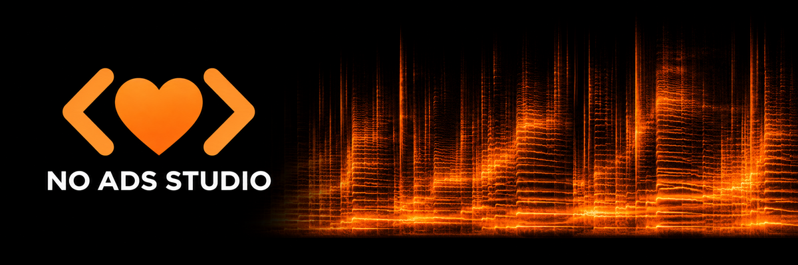
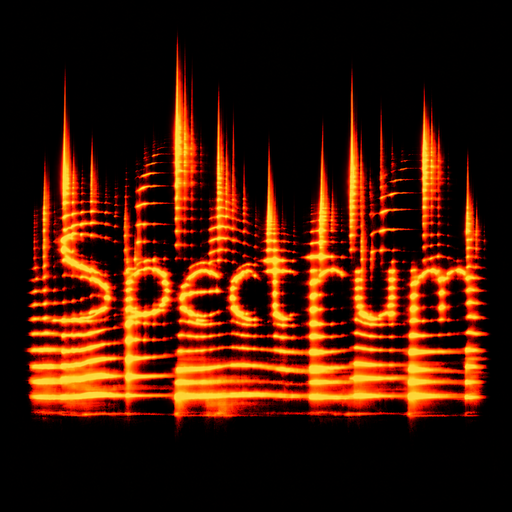

# Spectrum Audio

**Visualisez le son, explorez vos musiques et révélez leurs images cachées.**

Une application Android gratuite de **No Ads Studio**, sans publicité, pour analyser le microphone ou les fichiers audio de votre téléphone. Fond noir, commandes orange et spectrogramme détaillé.

**[Télécharger SpectrumAudio.apk](https://github.com/rafale21/Spectrum-Audio/releases/latest/download/SpectrumAudio.apk)** · **[Dernière version et empreintes de contrôle](https://github.com/rafale21/Spectrum-Audio/releases/latest)** · **[English](README.md)**

Android **8.0 ou supérieur** · Version **1.21** · Aucun compte nécessaire dans l’application.

## Curseur de lecture

Le trait blanc reste visible pendant la lecture. La vue avance quand le curseur atteint le bord, sans modifier le zoom. Pour garder la vue fixe : **Réglages → Suivre automatiquement la lecture**, désactivez puis **Appliquer**. Le choix est mémorisé. Les gestes sur le graphe restent prioritaires tant que le doigt ou le bouton de souris est maintenu. En pause ou en fin de lecture, le curseur disparaît après 1,5 seconde d’inactivité.

## Fonctionnalités

- Spectrogramme du microphone en direct et enregistrement audio.
- Import et lecture de fichiers M4A/AAC, MP3, WAV, FLAC et OGG, selon les codecs pris en charge par votre appareil.
- Appui sur le spectrogramme pour déplacer la lecture ; glissement pour parcourir le fichier.
- Zoom temporel par pincement horizontal, boutons −/+ ou molette ; option de compatibilité pour les émulateurs.
- Analyse adaptative des fichiers importés pour affiner les détails de la zone observée.
- Précision réglable de 512 à 8 192 échantillons, fréquence maximale affichée, contraste et palette réglables.
- Préréglages intégrés « Par défaut » et « Images cachées », et trois mémoires personnelles.
- Sauvegarde automatique à la fin d’une prise, annulation de l’enregistrement en cours et gestion des prises.
- Export OGG/Opus, WAV ou M4A/AAC. Opus nécessite Android 10 ou supérieur ; une sauvegarde WAV conserve la prise si l’encodage échoue.
- Capture PNG du spectrogramme visible.
- Orientation automatique, portrait ou paysage ; sélection manuelle de la langue, dont le klingon.

Réglages initiaux : **1 024 échantillons, fréquence maximale affichée 16 000 Hz**. Cette limite d’affichage ne désigne pas la fréquence d’échantillonnage du son : le microphone est capturé en mono à 48 kHz.

## Installation et mise à jour

1. Téléchargez **SpectrumAudio.apk** depuis la publication officielle ci-dessus.
2. Ouvrez le fichier. Si Android le demande, autorisez l’installation depuis le navigateur ou le gestionnaire de fichiers utilisé.
3. Confirmez l’installation. Vous pouvez ensuite désactiver cette autorisation d’installation.
4. Autorisez le microphone lorsque vous souhaitez l’utiliser pour l’analyse ou l’enregistrement.

Les archives « Source code » de GitHub contiennent les sources à l’étiquette de la version. **Choisissez l’APK pour installer l’application**, ou les sources pour étudier et compiler le projet.

Pour les futures mises à jour de ce nouvel identifiant, installez le nouvel APK officiel par-dessus cette version. L’identifiant et la signature doivent être compatibles. Avant une désinstallation, sauvegardez vos prises : les copies exportées et les données privées de l’application ne sont pas la même chose.

**Vous utilisez une version antérieure à 1.20 ?** La version 1.20 a introduit un nouvel identifiant Android et s’installe séparément, même avec la même clé officielle. Elle peut coexister avec l’ancienne ; les prises privées et les réglages ne sont pas transférés automatiquement. [Consignes de migration](SIGNING.md).

## Utilisation rapide

**Microphone :** passez en mode microphone et démarrez l’analyse. Le bouton d’enregistrement capture une prise ; l’arrêt de la prise déclenche sa sauvegarde. Le bouton d’annulation abandonne la prise en cours.

**Fichier audio :** ouvrez un fichier, attendez son analyse et lancez la lecture. Appuyez sur le spectrogramme pour déplacer la lecture, faites-le glisser pour le parcourir et pincez horizontalement pour zoomer. Le curseur blanc s’efface après 1,5 seconde sans interaction et réapparaît à la manipulation.

**Images cachées :** sélectionnez ce préréglage dans les réglages, puis Appliquer. Le résultat dépend du fichier et des réglages d’analyse. L’application permet de visualiser ces images, pas d’en insérer dans la musique.

**P1/P2/P3 :** appui long pour mémoriser les réglages du formulaire, appui court pour les rappeler, puis Appliquer.

**Exports :** les copies audio publiques sont dans `Music/Spectrum Audio` et les captures dans `Pictures/Spectrum Audio`. Vérifiez l’accès aux fichiers importants depuis une autre application avant toute désinstallation.

## Confidentialité et assistance

Le traitement audio se fait sur votre appareil. L’application ne demande pas la permission Internet et n’intègre ni SDK publicitaire ni SDK de statistiques. Le bouton de don ouvre Ko-fi dans votre navigateur externe.

[Confidentialité](PRIVACY.md#français) · [Historique des versions](CHANGELOG.md) · [Utilisation et redistribution](USAGE.md)

Pour une question ou un problème, [ouvrez un ticket GitHub](https://github.com/rafale21/Spectrum-Audio/issues) avec le modèle du téléphone, la version Android et les étapes pour reproduire le problème. Les tickets sont publics : n’y publiez pas de données personnelles ni de prises confidentielles.

## Soutenir No Ads Studio

**[Notre page Ko-fi](https://ko-fi.com/noadsstudio)** permet de soutenir nos applications. Le don est facultatif, sans contrepartie, et ne débloque aucune fonction.

## Ce dépôt

Il s’agit de la **page officielle de distribution et d’assistance** de Spectrum Audio. Les sources et tests sont dans [android/](android/). Consultez [BUILDING.md](BUILDING.md) pour compiler et [CONTRIBUTING.md](CONTRIBUTING.md) pour contribuer. Le projet est sous [GPLv3 uniquement](LICENSE), avec les exceptions d’outillage décrites dans [THIRD_PARTY.md](THIRD_PARTY.md). L’icône et la bannière sont des visuels de présentation, pas des captures d’écran de l’interface.
