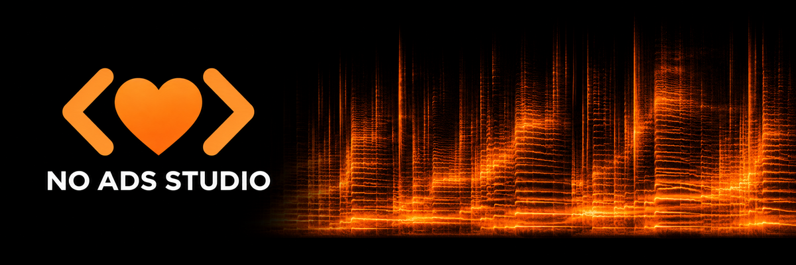
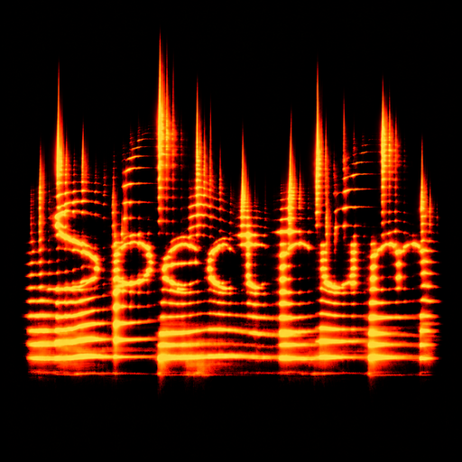

# Spectrum Audio

**See sound. Explore music. Reveal hidden spectral images.**

A free Android audio spectrogram app by **No Ads Studio**, with microphone analysis, audio-file playback and an adaptive detailed view. Black background, orange controls, and no ads.

**[Download SpectrumAudio.apk](https://github.com/rafale21/Spectrum-Audio/releases/latest/download/SpectrumAudio.apk)** · **[Latest release and checksums](https://github.com/rafale21/Spectrum-Audio/releases/latest)** · **[Français](README.fr.md)**

Android **8.0 or later** · Current release **1.21** · No account required in the app.

## Playback cursor

The white playhead stays visible during playback. The view advances when it reaches the edge, keeping the current zoom. Disable **Follow playback automatically** in Settings and tap Apply to keep the view still; the choice is remembered. Graph gestures take priority while held. In pause or at the end, the cursor hides after 1.5 seconds of inactivity.

## What you can do

- Visualize microphone sound as a scrolling spectrogram.
- Open local audio files, including M4A/AAC, MP3, WAV, FLAC and OGG, subject to the device's codec support.
- Play audio and tap the spectrogram to move the playhead.
- Drag the view and zoom along the time axis with a horizontal pinch, the −/+ buttons, or a mouse wheel. An emulator compatibility option is available.
- Explore finer detail as you zoom and move through an imported file, with adaptive analysis.
- Adjust FFT size (512 to 8,192 samples), displayed frequency range, contrast and display palette.
- Recall built-in presets, including **Hidden images**, and save three personal presets.
- Record, automatically save when finished, cancel a take, and manage recordings.
- Save recordings as OGG/Opus, WAV or M4A/AAC. Native Opus export requires Android 10+; a WAV fallback protects a take when encoding fails.
- Export a PNG of the visible spectrogram.
- Choose automatic, portrait or landscape orientation and an interface language, including Klingon.

The default analysis uses **1,024 samples** and a maximum **displayed frequency of 16,000 Hz**. This display limit is not the audio sample rate: microphone capture is 48 kHz mono.

## Install

1. Download **SpectrumAudio.apk** from the official release linked above.
2. Open the downloaded file. If Android requests it, allow the browser or file manager used to install apps from this source.
3. Confirm installation. You may disable that installation permission again afterward.
4. Grant microphone access when you want to analyze or record sound.

GitHub offers “Source code” archives containing the source tree at the release tag. **Choose the APK to install the app**, or the source archive to study or build it.

Future updates to this new application ID can be installed over this release. Android requires matching application IDs and compatible signatures. Back up recordings before uninstalling an app; exported copies and private app data are different.

**Coming from a version older than 1.20?** Version 1.20 introduced a new Android application ID and installs as a separate app, even with the same official signing key. It can coexist with the old app; private recordings and settings are not transferred automatically. [Read the migration instructions](SIGNING.md).

## Quick start

**Live sound:** select microphone mode and start analysis. Use the record control to capture a take; stopping a recording saves it automatically. Cancel discards the current take.

**Audio files:** open a file, wait for analysis, then play it. Tap to seek, drag to browse, and use horizontal pinch or −/+ to zoom. The white playhead fades after 1.5 seconds without interaction and reappears when you interact.

**Hidden images:** select the built-in preset in Settings, then Apply. Image visibility depends on the recording and analysis settings. Spectrum Audio reads spectral images; it does not embed images into audio.

**Personal presets:** adjust settings, long-press P1/P2/P3 to save, or short-press to recall, then Apply.

**Saved files:** public audio exports go to `Music/Spectrum Audio`; PNG exports go to `Pictures/Spectrum Audio`. Check that important exports are accessible outside the app before uninstalling it.

## Privacy and support

Audio processing is local. The app has no Internet permission, advertising SDK or analytics SDK. The optional donation control opens Ko-fi in your external browser.

[Privacy details / Confidentialité](PRIVACY.md) · [Release history](CHANGELOG.md) · [Usage and distribution](USAGE.md)

For a bug or suggestion, [open an issue](https://github.com/rafale21/Spectrum-Audio/issues). Include Android version, device model and reproduction steps. Do not post personal recordings or confidential information in public issues.

## Support No Ads Studio

If you would like to support our apps: **[No Ads Studio on Ko-fi](https://ko-fi.com/noadsstudio)**.

Donations are optional and unlock no features. All app features remain available without donating.

## About this repository

This is the official **APK distribution and support page** for Spectrum Audio by No Ads Studio. The complete Android project and regression tests are in [android/](android/). See [BUILDING.md](BUILDING.md) and [CONTRIBUTING.md](CONTRIBUTING.md). The project is licensed under [GPLv3 only](LICENSE), with tooling exceptions described in [THIRD_PARTY.md](THIRD_PARTY.md). The icon and banner are promotional artwork, not screenshots of the interface.
